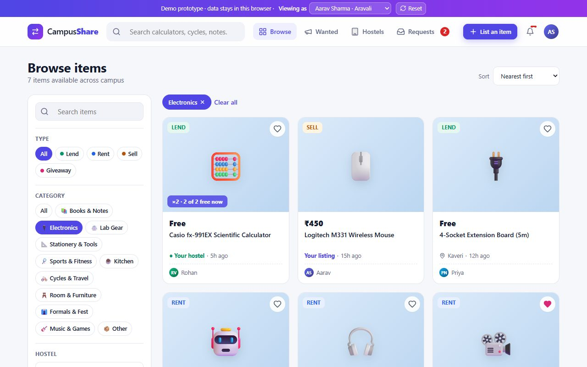
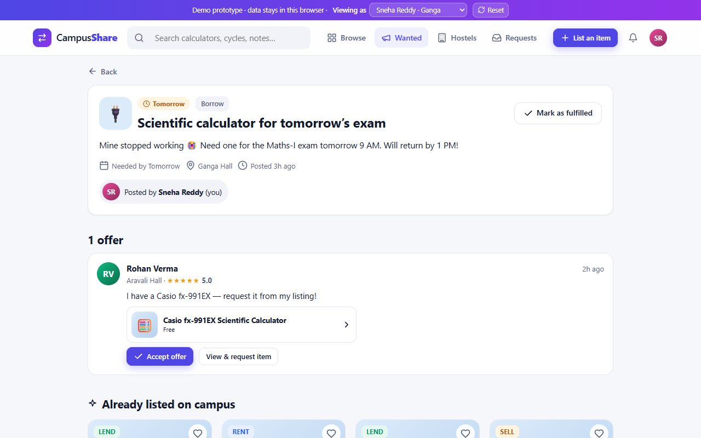
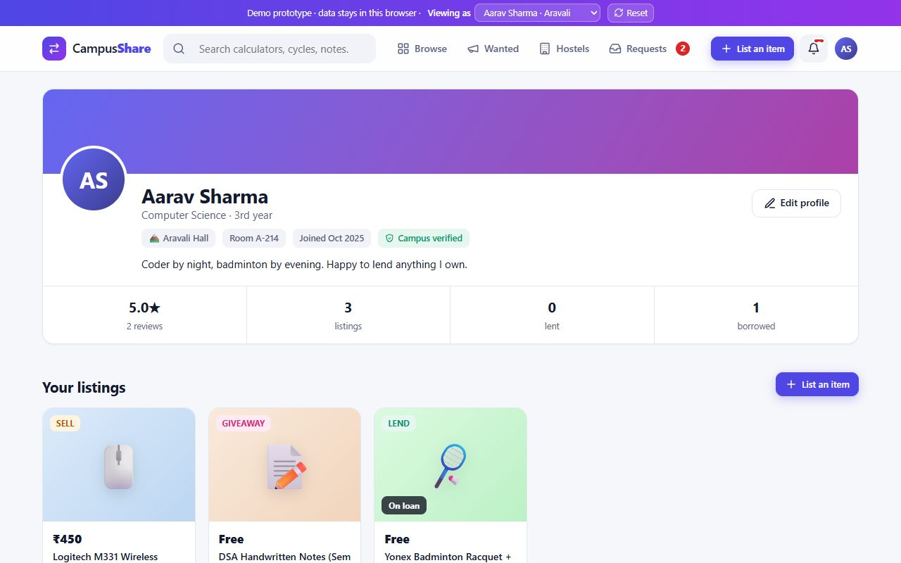

# CampusShare

**Borrow, lend, rent and share everyday items across campus hostels**

| | |
|---|---|
| **App link** | https://campus-share-bvs.netlify.app |
| **Source code** | https://github.com/bvsrikesh/campus-share |
| **Submitted by** | TODO: name, roll number |

---

## 1. Problem Statement

Hostel students often need things they use only a few times: a scientific calculator for one exam, a blazer for a placement interview, a cycle for a week, an extension board or a lab coat. Buying each one is wasteful, while the same items lie unused a few rooms away. Today students find them through scattered chat groups. Messages get buried, nobody can see what is available, and nothing stops two people being promised the same item.

**Objective.** Build a campus sharing platform where students can:

1. **List** items to lend (free), rent (per day), sell or give away, with quantity, condition, deposit and lending limits.
2. **Browse and search** items across all hostels, with items from their own hostel shown first.
3. **Request** an item with dates, pickup spot and a message. Track the request from accept to hand-over to return, with chat, notifications and ratings.
4. **Post what they need** on a Wanted board when nobody has listed it yet.
5. Use **hostels** as communities, and manage their own **account**, listings and requests.

**Key requirements.**
- **No double-booking**, including items with several units.
- **Privacy:** a room number is revealed only after a request is accepted.
- **Mobile-friendly and accessible.**
- **Easy to demonstrate:** a reviewer can act as both owner and borrower with no setup.

**Scope and assumptions.**
- This is a working prototype; data is stored in each visitor's browser.
- Sign-up is limited to campus emails.
- Payments and deposits are settled in person at pickup.
- Bookings are by whole days, at most 6 months ahead.
- All people, hostels and listings in the demo are fictional.

---

## 2. App Link

**Live app:** https://campus-share-bvs.netlify.app. It opens on any phone or laptop with no sign-up needed.

**Source code:** https://github.com/bvsrikesh/campus-share

**How to try it**
1. Use the **"Viewing as"** dropdown in the top banner to switch between 10 demo students. Password for all accounts: `demo123`.
2. As **Kabir Singh**, open **Requests**: one request clashes with an existing booking, so Accept is blocked.
3. As **Rohan Verma**, open the **Casio calculator**: it has 2 units, so two people can borrow it at once.
4. **Reset** in the banner restores the demo data at any time.

---

## 3. Prompts

The application was built in five steps. Each step's prompt is below.

### Prompt 1: Build the application

```text
Build "CampusShare", a web application where hostel students borrow, lend, rent,
sell and give away everyday items (calculators, cycles, lab coats, notes, formal
wear, kitchen items) instead of buying them for one-time use.

TECH
- Plain HTML + CSS + vanilla JavaScript. No framework, no build step: the app must
  open by double-clicking index.html and must deploy as static files.
- Hash-based routing (#/browse, #/item/<id>, ...) so every screen has a shareable
  URL and back/forward works.
- Store all data in localStorage. Seed realistic, fictional demo data on first load.
- Files: index.html, css/styles.css, js/data.js (constants + seed), js/app.js
  (store, router, pages, actions), README.md.

DATA MODEL
- hostels: id, name, short name, type (Boys/Girls/Co-ed PG), blocks, capacity,
  colour, emoji, description. Seed 6.
- users: id, name, campus email, password, hostelId, room, department, year, bio,
  avatar colour, joined date, saved item ids. Seed 10.
- items: id, ownerId, hostelId, title, category, type (lend | rent | sell | free),
  price (rent = per day), refundable deposit, max lending days, condition,
  description, emoji or uploaded photo, status, views, created date. Seed ~30.
- requests: id, itemId, requesterId, ownerId, type, status, from/to dates (lend/rent),
  offer price (sell), pickup spot, messages[], status history, created/updated.
- wanted posts: id, userId, hostelId, title, category, mode (borrow/rent/buy/any),
  budget, needed-by date, description, status, offers[].
- reviews (1-5 stars + text) and notifications (text, link, read flag).
- 11 categories (Books & Notes, Electronics, Lab Gear, Stationery & Tools, Sports,
  Kitchen, Cycles & Travel, Room & Furniture, Formals & Fest, Music & Games, Other).

PAGES
1. Home: hero with search and popular searches; live stats; "needs your
   attention" cards for the logged-in user (requests to answer, pickups, returns
   due); category tiles with counts; items in your hostel; fresh listings; urgent
   wanted posts; hostel strip; "how it works" for visitors.
2. Browse: search, filters (type, category, hostel, max price, available now),
   active-filter chips, sort (nearest first = viewer's hostel, newest, price).
   Empty search result offers "post this as a wanted request".
3. Item page: large image, type badge, price, description, facts (condition, max
   period, deposit, pickup hostel), owner card with rating, similar items.
   The side panel depends on the viewer:
   - visitor: log-in prompt;
   - owner: edit / pause / relist / delete, and the item's requests with quick
     Accept/Decline;
   - other user: the request form.
4. Request form:
   - lend/rent: date range with live cost estimate (days x price + deposit);
   - sell: an offer price;
   - every type: pickup spot select, message with quick-message chips.
5. Request page: status timeline (Requested -> Accepted -> Handed over -> Returned),
   details, role-based action buttons, chat, the other person's profile card, safety
   tips. Show the other person's room number only after acceptance.
6. Requests: Received / Sent tabs, status filters, inline Accept/Decline.
7. List an item / Edit: type selector cards, fields that adapt to the type, photo upload
   (resize to 640px JPEG) or emoji picker, live preview card, tips.
8. Wanted board: post a need (modal), filter, urgency badges (today / tomorrow /
   in N days); detail page with offers (others can attach one of their listings),
   accept an offer, mark fulfilled, reopen.
9. Hostels directory and hostel page (stats, wanted posts, listings, members).
10. Profile: cover, details, stats (rating, listings, lent, borrowed), listings,
    wanted posts, reviews; edit profile.
11. Saved items, Log in (with one-click demo accounts), Sign up (campus email only).

REQUEST LIFECYCLE
pending -> accepted (owner) -> active / handed over (owner) -> completed (owner
confirms return); pending -> declined (owner); pending/accepted -> cancelled (either
side). For sell/giveaway the hand-over completes the exchange and marks the item
sold/claimed. After completion both sides can rate each other once. Notify the other
side of every change, every new request and every new message.

UX
- Header: logo, search, nav (Browse, Wanted, Hostels, Requests with badge), "List an
  item", notification bell with dropdown, account menu.
- Mobile: bottom tab bar with a central "+" button; no horizontal scrolling.
- Light and dark themes (remember the choice). Toast messages. Empty states that
  suggest the next action. Keyboard: "/" focuses search, Esc closes dialogs.
- Escape every piece of user text before rendering it as HTML.
```

### Prompt 2: Booking integrity and a two-sided demo

```text
Improve CampusShare's request flow and demo experience.

1. Prevent double-booking. For lend/rent items, an owner must not be able to accept a
   request whose dates overlap an accepted or active booking. Instead of the Accept
   button show a red label: "Clashes with <name>'s booking (<from> -> <to>)".
   When a request is accepted, automatically decline the pending requests whose
   dates overlap it and notify those requesters.
2. On the item page show the already-booked date ranges, default the date picker
   to the first free window, warn live when chosen dates overlap a booking, and
   reject such a submission.
3. Two-step return: the borrower can tap "I've returned it" (notifies the owner,
   shows "waiting for confirmation"), then the owner confirms the return.
4. Add an always-visible "Viewing as" dropdown in the top banner listing every demo
   student plus "guest", and a Reset button, so one person can demo both sides of an
   exchange. When switching from a private page (request, edit), go to Requests.
5. Seed one pending request that clashes with an accepted booking and one that
   doesn't, so the guard is visible in the demo. Bump the storage version so
   existing browsers reload the seed.
```

### Prompt 3: Quantity, duplicates and consistency rules

```text
Make CampusShare's data impossible to get into an inconsistent state.

QUANTITY
- Add a quantity field (1-50) to listings. For lend/rent, a date range is full
  only when, on some day in it, every unit is booked (count bookings per day).
  For sell/giveaway, each completed hand-over uses one unit; the item becomes
  Sold/Claimed when none are left; reservations (accepted requests) also hold units.
- Show stock: "x2 - 1 of 2 free now" on cards and item pages.
- Derive item status (available / on loan / sold / claimed) from the requests
  after every change. Never set it by hand. Only paused/removed are manual.

DUPLICATES
- If a user lists a title they already have (case- and punctuation-insensitive),
  show a dialog: "Add N to existing listing (-> total)" or "Post as a separate
  listing". The same item from different owners stays as separate listings.

GUARDS (re-check at the moment of the click, never trust the button on screen)
- Every request action checks the user's role (owner/requester) and the request's
  current status; otherwise show "That request has already changed" and refresh.
  This must survive old tabs, double clicks and forged buttons.
- Only owners manage their listings; only posters manage their wanted posts.
- A second open request for the same item by the same person is rejected.
- No accepting a request whose dates have passed.
- Listings with open requests: no type change, no quantity below units already
  committed, no max period shorter than an open request. No delete while on loan;
  deleting cancels pending/accepted requests and notifies the requesters.

VALIDATION
- Titles of at least 3 characters; whitespace trimmed and collapsed.
- Prices and deposits from 0 to Rs 1,00,000; rent and sell need a price.
- Offers from Rs 1 to twice the asking price.
- Dates: none in the past, end after start, at most 6 months ahead, within the
  max lending period.
- Sign-up: a valid campus email (campus.edu / .edu / .ac.in) that isn't already
  used (case-insensitive), non-blank name/room/department, a password of 6+ characters.
- Wanted posts: "needed by" not in the past.
- One offer per person per wanted post; one rating per side per exchange.
- When a user changes hostel, move their listings and open wanted posts with them.

DEMO DATA
- Give one calculator 2 units, and add the same calculator model from a second
  owner. Bump the storage version.
```

### Prompt 4: End-to-end test suite in a real browser

```text
Write an end-to-end test suite for CampusShare using puppeteer-core with the
installed Microsoft Edge (configurable to Chrome). `npm test` runs it.

STRUCTURE
- Groups; each group starts from fresh demo data, and every group also asserts
  that no JavaScript error occurred in the page.
- Helpers: navigate by hash, switch user through the "Viewing as" dropdown, fill
  and submit forms, read the toast, read stored state from localStorage.
- Print PASS/FAIL per check with details on failure; summary at the end; ONLY=<n>
  runs a single group.

GROUPS
1. Every route renders for a guest and three different users; unknown URL shows
   a 404; outsiders cannot open someone else's request.
2. Accounts: wrong password, login redirect, session after reload, logout;
   sign-up rejects non-campus, duplicate (any case), blank-name and malformed emails.
3. Listing validation; listing the same title twice -> merge or separate;
   the same object from two owners both appear in search; HTML in a title is shown
   as text and never executed.
4. Quantity: three borrowers ask for a 2-unit item on the same dates -> two accepted,
   third auto-declined and notified; a fourth is blocked for those dates but can book
   other dates; hand-overs move "1 of 2 free" -> "on loan" -> back to available.
5. Single item: clash label, overlapping/past/reversed/too-long/far-future dates,
   forced duplicate request, stale request with past dates.
6. Sell/giveaway: offer limits (browser validation and app validation), reservation,
   buyer backs out, sold out, relist; a 2-unit giveaway becomes claimed.
7. Full lend lifecycle: notification -> chat -> room hidden then revealed ->
   hand-over -> no delete while on loan -> two-step return -> ratings once only.
8. Stale state: a second tab declines a request; the first tab refreshes and
   rejects its old Accept; forged buttons for the wrong user; double-click Accept is
   recorded once.
9. Editing/deleting listings with open requests.
10. Wanted board: validation, offers with attached listing, one offer per person,
    accept -> fulfilled, reopen, "post this search as wanted".
11. Profile (hostel change moves listings), saved items, notifications, guest heart.
12. Filters, live search keeps focus, back/forward, "/" shortcut, theme persistence,
    reset.
13. Mobile 390px: no horizontal overflow on 12 pages, bottom bar, filter drawer.

RULE
When a check fails, first decide whether the bug is in the test or in the app.
Fix the real cause; never weaken an assertion to get a green run.
```

### Prompt 5: Accessibility and performance audit

```text
Serve CampusShare locally and run Lighthouse with Edge in desktop and mobile
modes. Report the Performance, Accessibility, Best Practices and SEO scores plus
First Contentful Paint, Largest Contentful Paint, Total Blocking Time and
Cumulative Layout Shift. List every failing audit with the exact element. Fix
contrast and labelling problems so they meet WCAG AA in both light and dark themes,
without changing the light-theme design. Re-run and report before/after, then re-run
the end-to-end suite.
```


---

## 4. Evaluations

### 4.1 Automated end-to-end tests: 159 / 159 passed

The suite (`tests/browser-tests.js`) drives **Microsoft Edge** and clicks real buttons. Every group also asserts **zero JavaScript errors**.

| # | Group | Checks | Result |
|---|---|---|---|
| 1 | Every page renders (28 routes × guest + 3 users, 404, access control) | 8 | Pass |
| 2 | Accounts: login, logout, sign-up validation, protected pages | 15 | Pass |
| 3 | Listing validation, duplicate listings, same item from two owners, HTML escaping | 14 | Pass |
| 4 | Quantity: 3 borrowers for 2 units, auto-decline, stock status | 16 | Pass |
| 5 | Single item: double-booking and date rules | 14 | Pass |
| 6 | Sell/giveaway: offers, reservation, sold out, relist | 14 | Pass |
| 7 | Full lifecycle: chat, privacy, hand-over, two-step return, ratings | 20 | Pass |
| 8 | Stale tabs, wrong user, double clicks | 7 | Pass |
| 9 | Editing/deleting listings with open requests | 13 | Pass |
| 10 | Wanted board | 15 | Pass |
| 11 | Profile, hostels, saved items, notifications | 9 | Pass |
| 12 | Filters, search, navigation, theme, reset | 10 | Pass |
| 13 | Mobile layout (390 px) | 4 | Pass |
| | **Total** | **159** | **159 passed, 0 failed, 0 JS errors** |

### 4.2 Defects found and fixed during evaluation

| Defect | How it was found | Fix |
|---|---|---|
| Two people could be accepted for the same dates | Design review of the request flow | Per-day booking model; clash label; auto-decline |
| No way to list 2 of the same item; duplicate listings created silently | Edge-case review | Quantity field; duplicate dialog |
| An old tab or double click could re-run Accept or Decline | Two-tab browser test | Every action re-validates the user and the current status |
| Item could be deleted while on loan; type could change under open requests | Edge-case tests | Blocked with an explanation |
| Request with already-passed dates could still be accepted | Edge-case test | Blocked |
| Blank names accepted at sign-up and in the profile | Validation test | Rejected |
| Clicking 4 stars could save 5 (hidden inputs overlapped the stars) | Rating test | Inputs made non-interactive |
| Stacked toast messages covered dialog buttons, so clicks were lost | Delete test | Max 3 toasts, click-through |
| Content scrolled sideways on phones | Mobile screenshots | Layout overflow guards |
| Low contrast in dark mode; icon-only button without a label | Accessibility check | Darker button colour; `aria-label` |

---

## 5. Demo

Screenshots of the implemented features, taken from the running application.

### 5.1 Home page


Search, popular searches and live campus statistics.

### 5.2 Personal dashboard and categories


For a logged-in student, the home page shows what needs attention: requests to answer, pickups and items lent out. Below that, every category with its count.

### 5.3 Browse with filters



Filter by type, category, hostel and price, with removable filter chips. Items from your own hostel are sorted first.

### 5.4 Item page and rent request


Already-booked dates are shown. The date picker starts on the first free window. A live estimate shows days × price plus the refundable deposit. Pickup spot and quick-message chips are included.

### 5.5 Multiple units of one item


This calculator has 2 units ("2 of 2 free now"), so two students can borrow it on the same dates.

### 5.6 Double-booking guard


The owner cannot accept Arjun's request because it clashes with Aarav's accepted booking. Sneha's request, on other dates, can be accepted.

### 5.7 Request page: timeline and chat


The progress timeline, request details and role-based actions. After acceptance the chat shows the owner's hostel and room.

### 5.8 List an item with live preview


Four sharing modes; the fields adapt to the mode. Quantity and deposit fields. The preview card updates as you type.

### 5.9 Duplicate listing detection


Listing something you already listed offers to add the unit to the existing listing instead of creating a duplicate.

### 5.10 Wanted board


Students post what they need, with urgency badges, budget and mode.

### 5.11 Wanted post with an offer



Another student offers help and attaches their own listing. The poster can accept the offer or mark the post fulfilled.

### 5.12 Notifications


New requests, offers and decisions, with unread markers and "mark all read".

### 5.13 Hostel page


Each hostel has its stats, open wanted posts, listings and members.

### 5.14 Profile



Hostel, verified badge, rating, sharing stats, listings and reviews.

### 5.15 Log in with demo accounts


Campus-email login, plus one-click demo accounts.

### 5.16 Mobile: light and dark themes

<p class="pair"> </p>

The phone layout has a bottom tab bar and a central "+" button, with no sideways scrolling. The light and dark themes are remembered per device.
