# CampusShare

**Borrow, lend, rent and share everyday items across campus hostels**

**App link:** https://campus-share-bvs.netlify.app

---

## 1. Problem Statement

Hostel students often need things they use only a few times: a scientific calculator for one exam, a blazer for a placement interview, a cycle for a week, an extension board or a lab coat. Buying each one is wasteful, while the same items lie unused a few rooms away. Today students find them through scattered chat groups. Messages get buried, nobody can see what is available, and nothing stops two people being promised the same item.

**Objective.** Build a campus sharing platform where students can:

1. **List** items to lend (free), rent (per day), sell or give away, with quantity, condition, deposit and lending limits.
2. **Browse and search** items across all hostels, with items from their own hostel shown first.
3. **Request** an item with dates, pickup spot and a message. Track the request from accept to hand-over to return, with chat, notifications and ratings.
4. **Post what they need** on a Wanted board when nobody has listed it yet.
5. Use **hostels** as communities, and manage their own **account**, listings and requests.

### Feature highlights

> **Four ways to share.** Lend (free), Rent (per day), Sell, Giveaway: one listing and request flow covers all four.
>
> **Multi-unit items.** An owner can list 5 extension boards. One student requests 2, another the remaining 3, and both are accepted. A further request is blocked or auto-declined because no units are left.
>
> **No double-booking.** Dates count as full only when every unit is booked. Clashing requests show "Clashes with Aarav's booking" instead of Accept, and are auto-declined when another request takes their slot.
>
> **Full request lifecycle.** Request → Accept → Hand-over → Return, with overdue warnings and a two-step return (borrower marks returned, owner confirms).
>
> **Chat on every request.** Borrower and owner message each other inside the request to agree on time and place, with notifications for new messages.
>
> **Rating system.** After each completed exchange both sides rate each other (1–5 stars plus a comment), once per exchange. Ratings and reviews show on profiles, item pages and offers, which builds trust.
>
> **Wishlist.** Tap ♥ on any item to save it to your wishlist and come back when it's free.
>
> **Smart request form.** It shows already-booked dates and starts on the first free window. A live estimate shows days × units × price plus deposit. Offers on items for sale.
>
> **Wanted board.** Ask for items nobody has listed. Others offer help and can attach their own listing.
>
> **Hostel communities.** Items from your hostel come first, and every hostel has a page with its listings, members and stats.
>
> **Notifications.** A bell with an unread count for new requests, decisions, messages, offers and returns.
>
> **Privacy and safety.** A room number is revealed only after acceptance, and all text is escaped. Every action is re-checked, so old tabs, double clicks and forged buttons can't corrupt data.
>
> **Duplicate detection.** Listing something you already listed offers to add units to the existing listing instead.
>
> **Easy to demonstrate.** The "Viewing as" switcher lets one reviewer act as owner and borrower in one click.
>
> **Works everywhere.** Mobile layout with a bottom tab bar, light and dark themes, keyboard shortcuts. Opens from a link with nothing to install.

**Scope and assumptions.**
- This is a working prototype; data is stored in each visitor's browser.
- Sign-up is limited to campus emails.
- Payments and deposits are settled in person at pickup.
- Bookings are by whole days, at most 6 months ahead.
- All people, hostels and listings in the demo are fictional.

---

## 2. App Link

**Live app:** https://campus-share-bvs.netlify.app. It opens on any phone or laptop with no sign-up needed.

**How to try it**
1. Use the **"Viewing as"** dropdown in the top banner to switch between 10 demo students. Password for all accounts: `demo123`.
2. As **Kabir Singh**, open **Requests**: one request clashes with an existing booking, so Accept is blocked.
3. **Multi-unit:** as **Aarav Sharma**, open **4-Socket Extension Board** (Priya has 5). Set **How many? = 2** and send. Switch to **Rohan Verma** and request the remaining **3** for the same dates. Switch to **Priya Nair** → Requests and accept both. Any further request for those dates is blocked.
4. **Reset** in the banner restores the demo data at any time.

---

## 3. Prompts

The application was built in five steps. Each step started from one prompt describing the design and how to proceed.

### Prompt 1: Design and build the application

```text
Design and build "CampusShare", a website where hostel students share everyday
items instead of buying them for one-time use: calculators, cycles, lab coats,
notes, formal wear, kitchen items.

WHO USES IT
- Students living in different hostels on one campus. Most will use it on their
  phones, between classes.
- Every student is both an owner (lists things) and a borrower (requests things).

WAYS TO SHARE
- Lend for free, rent per day, sell, or give away. One listing flow and one request
  flow should cover all four, changing only what each case needs (dates for
  lending and renting, an offer price for selling).

WHAT A STUDENT SHOULD BE ABLE TO DO
1. Find things quickly: search, filter by category, type, hostel and price, and see
   items from their own hostel first.
2. Understand an item at a glance: photo, price, condition, deposit, how long it
   can be borrowed, who owns it and how others rated them.
3. Ask for an item: choose dates, a pickup spot and write a short message; see the
   cost before sending.
4. Follow the request from start to finish: requested, accepted, handed over,
   returned (or declined / cancelled), and talk to the other person inside it.
5. Rate each other after the exchange so trust builds over time.
6. Post a "wanted" request when nobody has listed what they need, and let others
   offer to help.
7. See their hostel as a community: its listings, members and open requests.
8. Keep track of everything: their listings, sent and received requests, a
   wishlist and notifications.

DESIGN PRINCIPLES
- Mobile first: large tap targets, a bottom navigation bar on phones, no sideways
  scrolling. Also offer light and dark themes.
- Privacy by default: show a student's room number only after their request is
  accepted.
- Never leave the user stuck: every empty page suggests the next step, and every
  action gives clear feedback.
- Easy to demonstrate: fill it with believable, fictional students, hostels and
  listings, so a reviewer can try every feature immediately.

HOW TO PROCEED
Start with the core loop (list → browse → request → accept → hand over → return),
make it work end to end, then add the community features (wanted board, hostel
pages, ratings, notifications) on top. Check each page on a phone-sized screen
as you go.
```

### Prompt 2: Make bookings trustworthy and the demo two-sided

```text
Review the request flow from both the owner's and the borrower's side and make it
trustworthy.

1. No double-booking. If someone has already been promised an item for certain
   days, nobody else can be accepted for those days. The owner should see why
   ("Clashes with Aarav's booking") instead of an Accept button, and other
   requests for those days should be declined automatically, with the requesters told.
2. Help the borrower avoid clashes: show which dates are already taken, suggest
   the first free dates, and warn before they send a request that can't work.
3. Returning should involve both people: the borrower says "I've returned it", the
   owner confirms after checking the item.
4. A reviewer must be able to play both roles without logging in and out: add an
   always-visible way to switch between demo students, and a way to reset the
   demo.
5. Include a demo situation that shows a clash, so the rule is visible right away.
```

### Prompt 3: Quantities, duplicates and consistency

```text
Real students own more than one of some things, and real use is messy. Make the
app handle this and never get into a contradictory state.

QUANTITIES
- A listing can have several units (for example 5 extension boards).
- A request can ask for several units ("How many?"). Example: Priya has 5 boards;
  Aarav asks for 2 and Rohan asks for the remaining 3 on the same dates. Both can be
  accepted. Anyone else asking for those dates is told there are none left, and
  pending requests that no longer fit are declined automatically.
- Always think in units: rent and deposit grow with the number of units, an item
  is "on loan" only when every unit is out, and something for sale is "sold" only
  when the last unit is gone.
- Always tell people what's left: "3 of 5 free now", "5 reserved for upcoming
  pickups".

DUPLICATES
- If a student lists something they already listed, ask whether to add it to the
  existing listing or post it separately.
- The same object from two different owners stays as two separate listings.

CONSISTENCY
- What the screen shows can be out of date (an old tab, a double click). Every
  action must be checked again at the moment it happens: is this the right person,
  and is the request still in the right state?
- Don't allow changes that would break promises already made: deleting an item
  someone is borrowing, switching "lend" to "sell" while requests are open, or
  lowering the quantity below what is already promised.
- Reject input that makes no sense: dates in the past, end before start, blank
  names, impossible prices or offers, a second request for the same item, a second
  rating for the same exchange.
```

### Prompt 4: Plan how to test it

```text
Plan how to prove the app works, and automate it so it can be re-checked after
every change.

- Test the way a student actually uses the app: open pages, click buttons, fill in
  forms, switch between students, in a real browser.
- Organise the checks by feature: pages and access, accounts, listings, quantities,
  dates and clashes, selling and giving away, the full borrowing journey, stale or
  wrong actions, editing listings, the wanted board, profiles and wishlist,
  navigation, the phone layout, and multi-unit requests.
- For every feature, include the normal case and the cases that should be refused.
- Start each group from the same demo data, and count any error in the page as a
  failure.
- When a check fails, first work out whether the check or the app is wrong, then
  fix the real cause. Never weaken a check just to make it pass.
```

### Prompt 5: Evaluate corner cases, fix what breaks, report results

```text
Go through CampusShare end to end and evaluate it against real-world corner cases.
For every case: try it in the running app as the right students, write down what
should happen, check what does happen, fix the app if they differ, and add a check
so it stays fixed.

CORNER CASES TO COVER (examples, not a complete list)
Same object, several units
- One owner has TWO of the same calculator. Two students must be able to borrow
  them on the same dates; a third asking for those dates must be blocked or
  declined, and must still be able to book other dates.
- One owner has FIVE extension boards. Student A asks for 2, student B for the
  remaining 3 on the same dates: both can be accepted. Student C asks for 4 on those
  dates: once A is accepted only 3 are left, so C is declined and told. Student D
  asks for 1: once B is accepted nothing is left, so D is declined. Nobody can ask
  for 6 of 5. Someone can still take all 5 on a different, free day.
- Renting several units: 2 units for 2 days at Rs 20 a day costs Rs 80, and the
  deposit doubles.
- Selling 5 chairs as 2 + 3 sells out; a third buyer is declined.
- Handing over 2 of 5 keeps the item available (3 of 5 free); handing over all 5
  makes it "on loan"; the owner can't lower the quantity below what is out.
Same object listed twice
- The same owner lists "Rice cooker" again: offer to add it to the existing
  listing or post it separately.
- Two different owners list the same calculator model: both appear in search and
  can be requested separately.
Booking and dates
- Two people want the same single cycle on overlapping dates: only one can be
  accepted; the other shows "Clashes with <name>'s booking".
- Past start date, end before start, longer than the owner allows, too far ahead,
  an old request whose dates have already passed.
Out-of-date screens and the wrong person
- Two tabs: one declines a request while the other still shows Accept. Clicking
  it must be refused, not applied.
- Double-clicking Accept counts once.
- A borrower trying an owner-only action, or someone pausing another person's
  listing, is refused.
- Sending a second request for an item you already asked for.
Listings that change while requests are open
- Deleting an item that is out on loan; switching lend to sell while requests are
  open; shortening the lending period below an open request.
Input and screen details
- Blank names, non-campus or repeated emails, zero / negative / unrealistic prices
  and offers, rating the same exchange twice, code typed into a title.
- Clicking the 4th star must give 4 stars; pop-up messages must never block
  buttons; nothing scrolls sideways on a phone; text stays readable in dark mode.

REPORT
1. A table of test groups with the number of checks and pass/fail (all must pass,
   with no errors in the page).
2. A table of every defect found: what was wrong, how it was found, how it was fixed.
```

---

## 4. Evaluations

### 4.1 Automated end-to-end tests: 185 / 185 passed

The suite (`tests/browser-tests.js`) drives **Microsoft Edge** and clicks real buttons. Every group also asserts **zero JavaScript errors**.

| # | Group | Checks | Result |
|---|---|---|---|
| 1 | Every page renders (28 routes × guest + 3 users, 404, access control) | 8 | Pass |
| 2 | Accounts: login, logout, sign-up validation, protected pages | 15 | Pass |
| 3 | Listing validation, duplicate listings, same item from two owners, HTML escaping | 14 | Pass |
| 4 | Quantity: 3 borrowers for 2 units, auto-decline, stock status | 16 | Pass |
| 5 | Single item: double-booking and date rules | 14 | Pass |
| 6 | Sell/giveaway: offers, reservation, sold out, relist | 14 | Pass |
| 7 | Full lifecycle: chat, privacy, hand-over, two-step return, ratings | 20 | Pass |
| 8 | Stale tabs, wrong user, double clicks | 7 | Pass |
| 9 | Editing/deleting listings with open requests | 13 | Pass |
| 10 | Wanted board | 15 | Pass |
| 11 | Profile, hostels, wishlist, notifications | 9 | Pass |
| 12 | Filters, search, navigation, theme, reset | 10 | Pass |
| 13 | Mobile layout (390 px) | 4 | Pass |
| 14 | Multi-unit requests: 2 of 5 + remaining 3, auto-decline, rent/deposit × units, 5-unit sale | 26 | Pass |
| | **Total** | **185** | **185 passed, 0 failed, 0 JS errors** |

### 4.2 Defects found and fixed during evaluation

| Defect | How it was found | Fix |
|---|---|---|
| Two people could be accepted for the same dates | Design review of the request flow | Per-day booking model; clash label; auto-decline |
| No way to list 2 of the same item; duplicate listings created silently | Edge-case review | Quantity field; duplicate dialog |
| A request could only take one unit, so 5 boards for an event needed 5 separate requests | Feature review | "How many?" field; every rule counts units |
| An old tab or double click could re-run Accept or Decline | Two-tab browser test | Every action re-validates the user and the current status |
| Item could be deleted while on loan; type could change under open requests | Edge-case tests | Blocked with an explanation |
| Request with already-passed dates could still be accepted | Edge-case test | Blocked |
| Blank names accepted at sign-up and in the profile | Validation test | Rejected |
| Clicking 4 stars could save 5 (hidden inputs overlapped the stars) | Rating test | Inputs made non-interactive |
| Stacked toast messages covered dialog buttons, so clicks were lost | Delete test | Max 3 toasts, click-through |
| Content scrolled sideways on phones | Mobile screenshots | Layout overflow guards |
| Low contrast in dark mode; icon-only button without a label | Accessibility check | Darker button colour; `aria-label` |

---

## 5. Demo

Screenshots of the implemented features, taken from the running application.

### 5.1 Home page

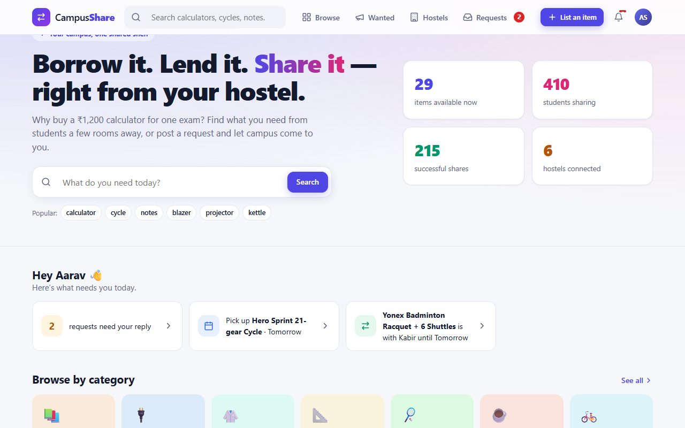

Search, popular searches and live campus statistics.

### 5.2 Personal dashboard and categories


For a logged-in student, the home page shows what needs attention: requests to answer, pickups and items lent out. Below that, every category with its count.

### 5.3 Browse with filters


Filter by type, category, hostel and price, with removable filter chips. Items from your own hostel are sorted first.

### 5.4 Item page and rent request


Already-booked dates are shown. The date picker starts on the first free window. A live estimate shows days × price plus the refundable deposit. Pickup spot and quick-message chips are included.

### 5.5 Requesting several units (2 of 5)


Priya has 5 extension boards. The request form asks **How many?**. Here a student asks for 2 of 5 and the estimate confirms "5 of 5 units free on these dates". Another student can then request the remaining 3.

### 5.6 Owner accepts 2 + 3, extra request auto-declined

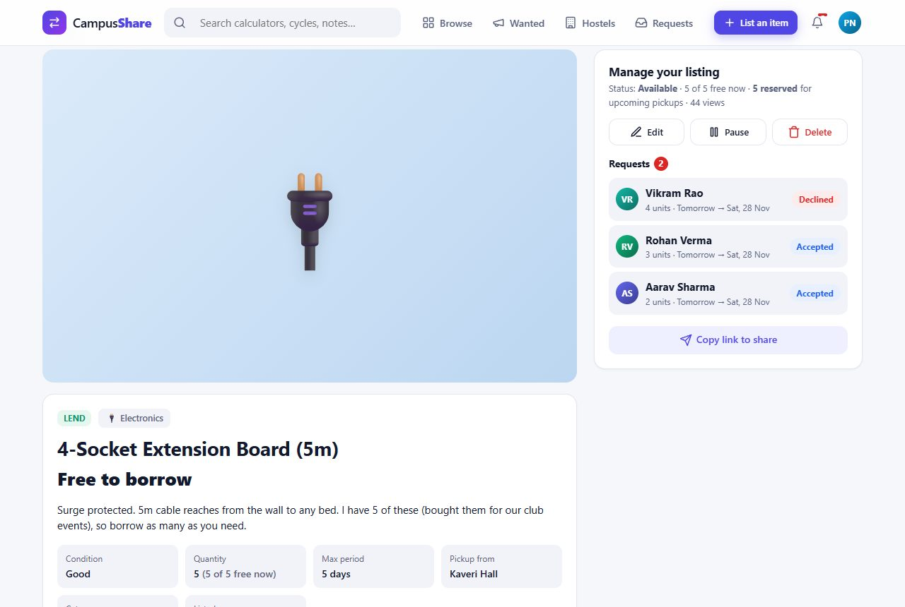

Aarav asked for 2 units and Rohan for the remaining 3, and the owner accepted both ("5 reserved for upcoming pickups"). Vikram's request for 4 units on the same dates was declined automatically and he was notified, because no units were left.

### 5.7 Double-booking guard

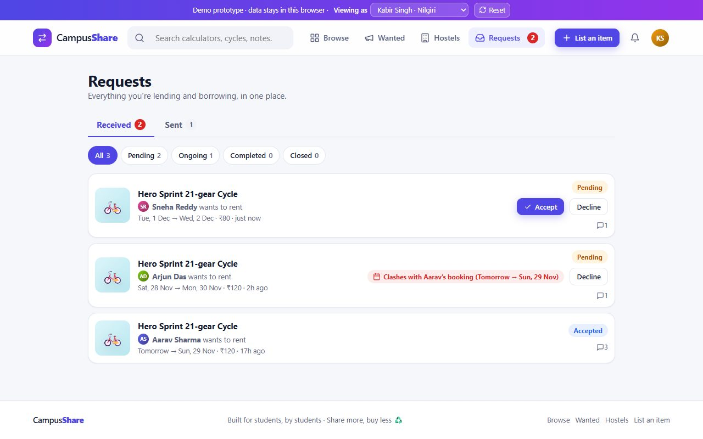

The owner cannot accept Arjun's request because it clashes with Aarav's accepted booking. Sneha's request, on other dates, can be accepted.

### 5.8 Request page: timeline and chat


The progress timeline, request details and role-based actions. After acceptance the chat shows the owner's hostel and room.

### 5.9 List an item with live preview

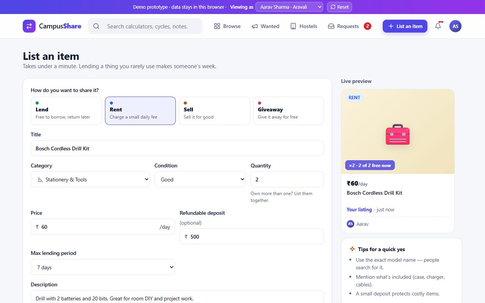

Four sharing modes; the fields adapt to the mode. Quantity and deposit fields. The preview card updates as you type.

### 5.10 Duplicate listing detection

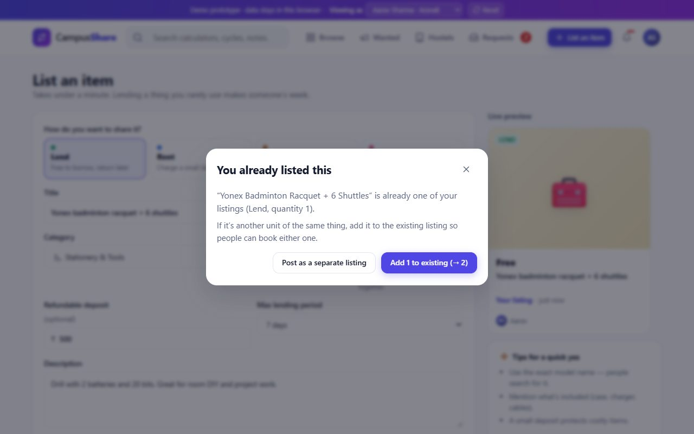

Listing something you already listed offers to add the unit to the existing listing instead of creating a duplicate.

### 5.11 Wanted board


Students post what they need, with urgency badges, budget and mode.

### 5.12 Wanted post with an offer


Another student offers help and attaches their own listing. The poster can accept the offer or mark the post fulfilled.

### 5.13 Notifications

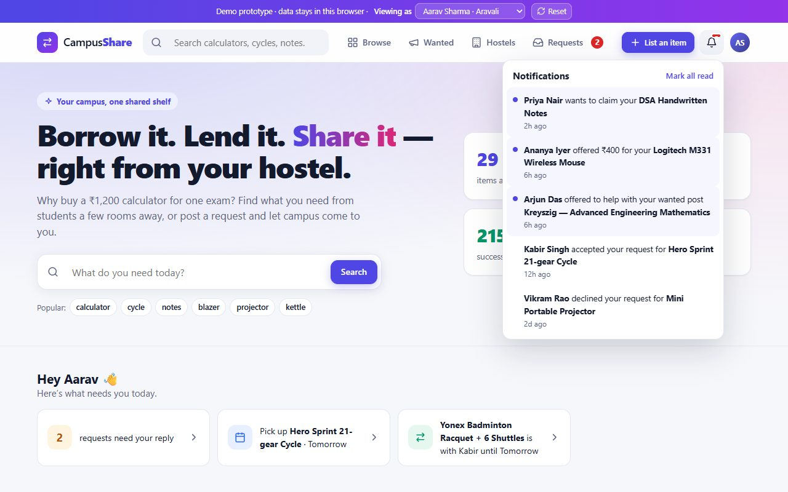

New requests, offers and decisions, with unread markers and "mark all read".

### 5.14 Hostel page

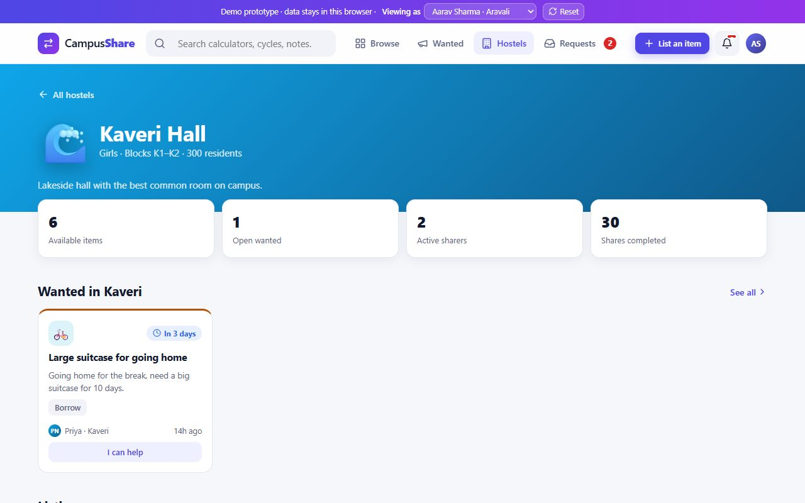

Each hostel has its stats, open wanted posts, listings and members.

### 5.15 Profile


Hostel, verified badge, rating, sharing stats, listings and reviews.

### 5.16 Rating system

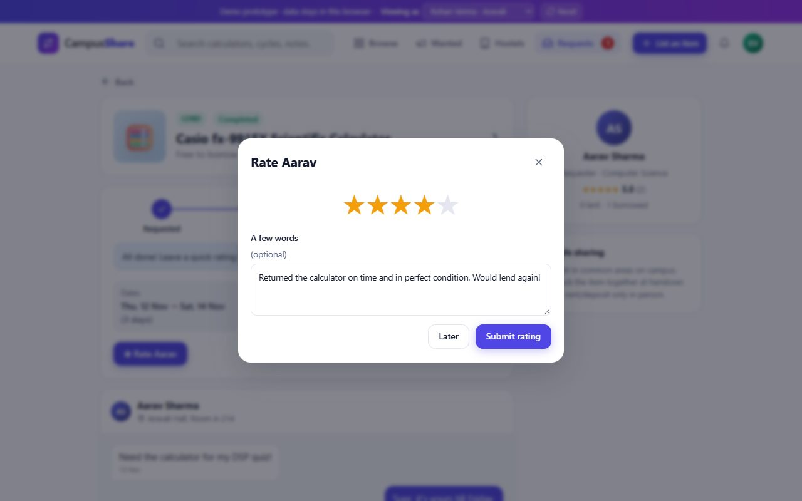

When an exchange is completed, each side rates the other once: 1–5 stars and an optional comment. Ratings appear on profiles, item pages and wanted-post offers.

### 5.17 Wishlist

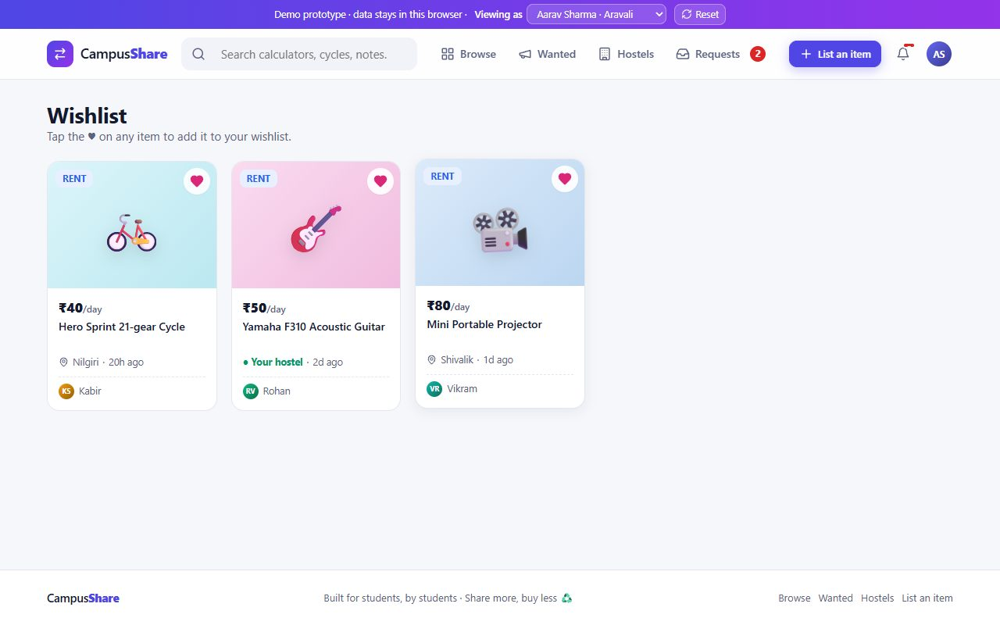

Tap ♥ on any item to add it to the wishlist and come back when it is free.

### 5.18 Log in with demo accounts

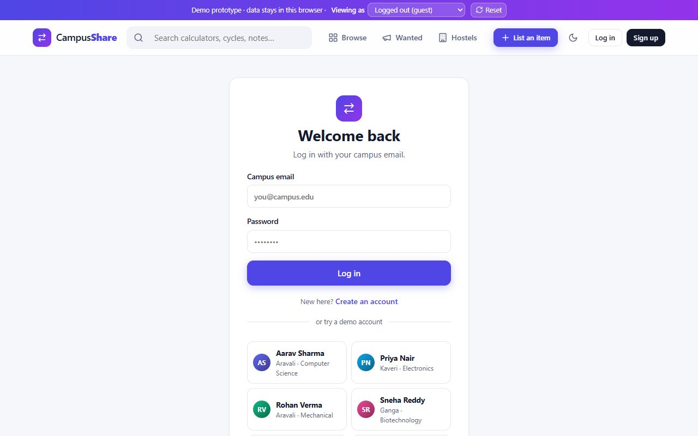

Campus-email login, plus one-click demo accounts.

### 5.19 Mobile: light and dark themes

<p class="pair">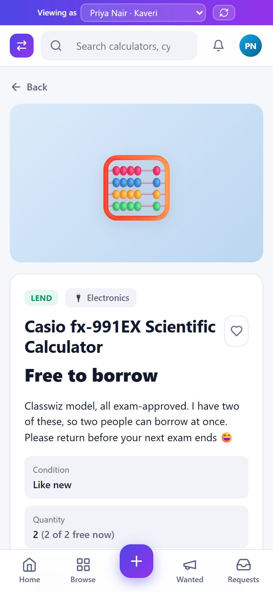 </p>

The phone layout has a bottom tab bar and a central "+" button, with no sideways scrolling. The light and dark themes are remembered per device.
