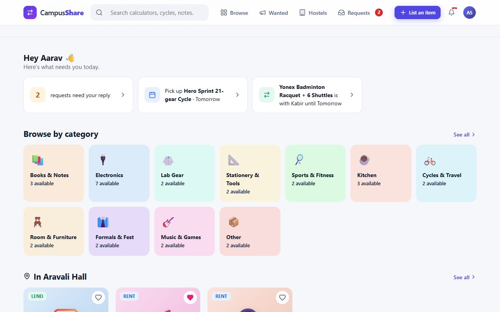
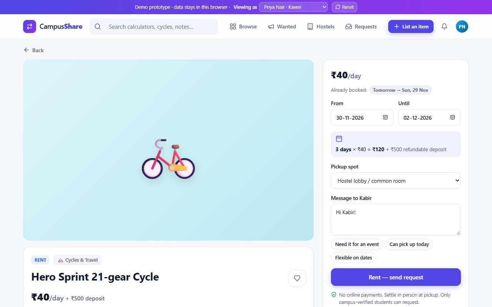
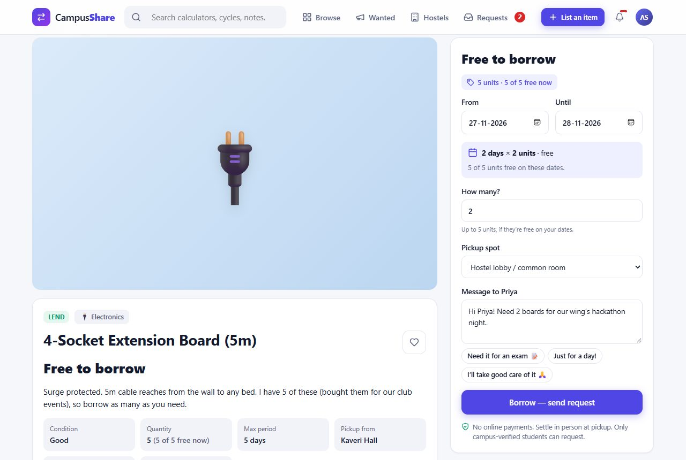
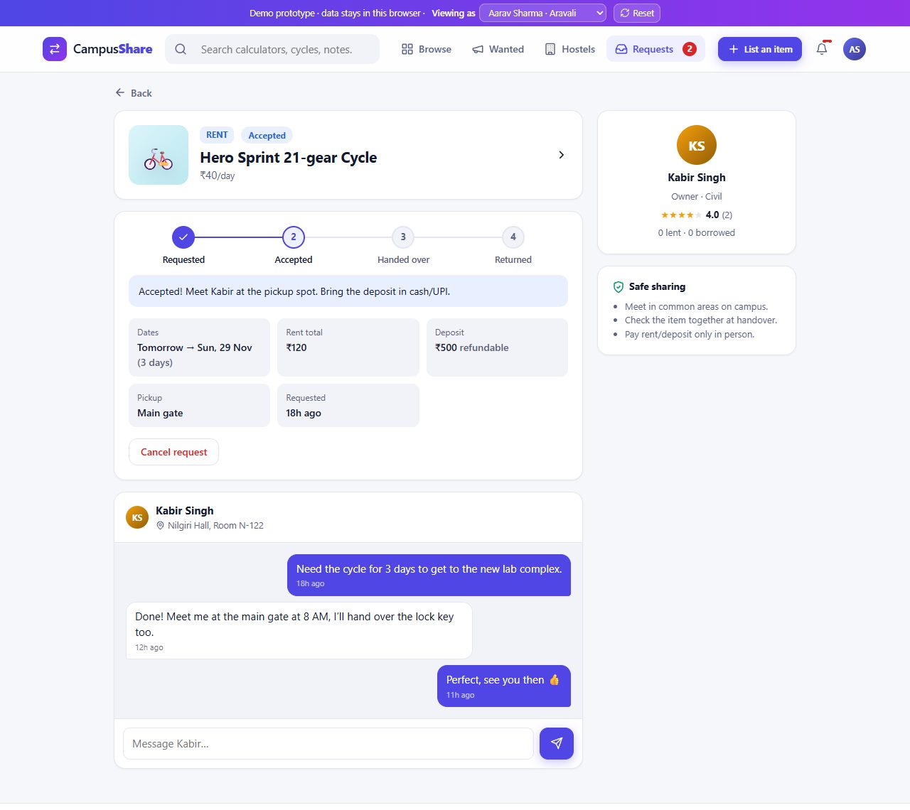
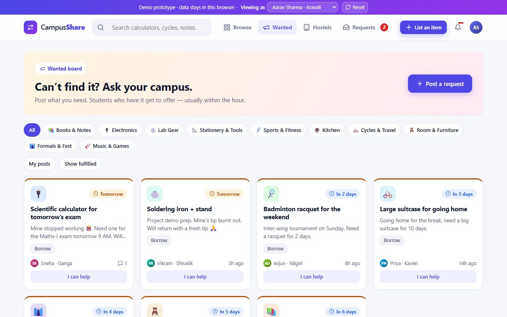
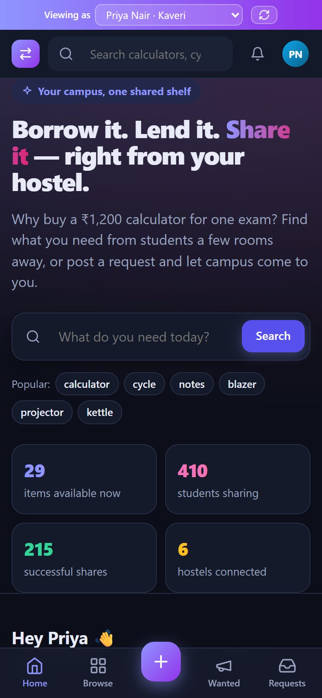

# CampusShare

**Borrow, lend, rent and share everyday items across campus hostels**

**App link:** https://campus-share-bvs.netlify.app

---

## 1. Problem Statement

Hostel students often need things they use only a few times: a scientific calculator for one exam, a blazer for a placement interview, a cycle for a week, an extension board or a lab coat. Buying each one is wasteful, while the same items lie unused a few rooms away. Today students find them through scattered chat groups. Messages get buried, nobody can see what is available, and nothing stops two people being promised the same item.

**Objective.** Build a campus sharing platform where students can:

1. **List** items to lend (free), rent (per day), sell or give away, with quantity, condition, deposit and lending limits.
2. **Browse and search** items across all hostels, with items from their own hostel shown first.
3. **Request** an item with dates, pickup spot and a message. Track the request from accept to hand-over to return, with chat, notifications and ratings.
4. **Post what they need** on a Wanted board when nobody has listed it yet.
5. Use **hostels** as communities, and manage their own **account**, listings and requests.

### Feature highlights

> **Four ways to share.** Lend (free), Rent (per day), Sell, Giveaway: one listing and request flow covers all four.
>
> **Multi-unit items.** An owner can list 5 extension boards. One student requests 2, another the remaining 3, and both are accepted. A further request is blocked or auto-declined because no units are left.
>
> **No double-booking.** Dates count as full only when every unit is booked. Clashing requests show "Clashes with Aarav's booking" instead of Accept, and are auto-declined when another request takes their slot.
>
> **Full request lifecycle.** Request → Accept → Hand-over → Return, with chat, notifications, overdue warnings, a two-step return (borrower marks returned, owner confirms) and ratings on both sides.
>
> **Smart request form.** It shows already-booked dates and starts on the first free window. A live estimate shows days × units × price plus deposit. Offers on items for sale.
>
> **Wanted board.** Ask for items nobody has listed. Others offer help and can attach their own listing.
>
> **Hostel communities.** Items from your hostel come first, and every hostel has a page with its listings, members and stats.
>
> **Privacy and safety.** A room number is revealed only after acceptance, and all text is escaped. Every action is re-checked, so old tabs, double clicks and forged buttons can't corrupt data.
>
> **Duplicate detection.** Listing something you already listed offers to add units to the existing listing instead.
>
> **Works everywhere.** Mobile layout with a bottom tab bar, light and dark themes, keyboard shortcuts. Opens from a link with nothing to install.

**Key requirements.**
- **No double-booking**, including items with several units.
- **Privacy:** a room number is revealed only after a request is accepted.
- **Mobile-friendly and accessible.**
- **Easy to demonstrate:** a reviewer can act as both owner and borrower with no setup.

**Scope and assumptions.**
- This is a working prototype; data is stored in each visitor's browser.
- Sign-up is limited to campus emails.
- Payments and deposits are settled in person at pickup.
- Bookings are by whole days, at most 6 months ahead.
- All people, hostels and listings in the demo are fictional.

---

## 2. App Link

**Live app:** https://campus-share-bvs.netlify.app. It opens on any phone or laptop with no sign-up needed.

**How to try it**
1. Use the **"Viewing as"** dropdown in the top banner to switch between 10 demo students. Password for all accounts: `demo123`.
2. As **Kabir Singh**, open **Requests**: one request clashes with an existing booking, so Accept is blocked.
3. **Multi-unit:** as **Aarav Sharma**, open **4-Socket Extension Board** (Priya has 5). Set **How many? = 2** and send. Switch to **Rohan Verma** and request the remaining **3** for the same dates. Switch to **Priya Nair** → Requests and accept both. Any further request for those dates is blocked.
4. **Reset** in the banner restores the demo data at any time.

---

## 3. Prompts

The application was built in five steps. Each step's prompt is below.

### Prompt 1: Build the application

```text
Build "CampusShare", a web application where hostel students borrow, lend, rent,
sell and give away everyday items (calculators, cycles, lab coats, notes, formal
wear, kitchen items) instead of buying them for one-time use.

TECH
- Plain HTML + CSS + vanilla JavaScript. No framework, no build step: the app must
  open by double-clicking index.html and must deploy as static files.
- Hash-based routing (#/browse, #/item/<id>, ...) so every screen has a shareable
  URL and back/forward works.
- Store all data in localStorage. Seed realistic, fictional demo data on first load.
- Files: index.html, css/styles.css, js/data.js (constants + seed), js/app.js
  (store, router, pages, actions), README.md.

DATA MODEL
- hostels: id, name, short name, type (Boys/Girls/Co-ed PG), blocks, capacity,
  colour, emoji, description. Seed 6.
- users: id, name, campus email, password, hostelId, room, department, year, bio,
  avatar colour, joined date, saved item ids. Seed 10.
- items: id, ownerId, hostelId, title, category, type (lend | rent | sell | free),
  price (rent = per day), refundable deposit, max lending days, condition,
  description, emoji or uploaded photo, status, views, created date. Seed ~30.
- requests: id, itemId, requesterId, ownerId, type, status, from/to dates (lend/rent),
  offer price (sell), pickup spot, messages[], status history, created/updated.
- wanted posts: id, userId, hostelId, title, category, mode (borrow/rent/buy/any),
  budget, needed-by date, description, status, offers[].
- reviews (1-5 stars + text) and notifications (text, link, read flag).
- 11 categories (Books & Notes, Electronics, Lab Gear, Stationery & Tools, Sports,
  Kitchen, Cycles & Travel, Room & Furniture, Formals & Fest, Music & Games, Other).

PAGES
1. Home: hero with search and popular searches; live stats; "needs your
   attention" cards for the logged-in user (requests to answer, pickups, returns
   due); category tiles with counts; items in your hostel; fresh listings; urgent
   wanted posts; hostel strip; "how it works" for visitors.
2. Browse: search, filters (type, category, hostel, max price, available now),
   active-filter chips, sort (nearest first = viewer's hostel, newest, price).
   Empty search result offers "post this as a wanted request".
3. Item page: large image, type badge, price, description, facts (condition, max
   period, deposit, pickup hostel), owner card with rating, similar items.
   The side panel depends on the viewer:
   - visitor: log-in prompt;
   - owner: edit / pause / relist / delete, and the item's requests with quick
     Accept/Decline;
   - other user: the request form.
4. Request form:
   - lend/rent: date range with live cost estimate (days x price + deposit);
   - sell: an offer price;
   - every type: pickup spot select, message with quick-message chips.
5. Request page: status timeline (Requested -> Accepted -> Handed over -> Returned),
   details, role-based action buttons, chat, the other person's profile card, safety
   tips. Show the other person's room number only after acceptance.
6. Requests: Received / Sent tabs, status filters, inline Accept/Decline.
7. List an item / Edit: type selector cards, fields that adapt to the type, photo upload
   (resize to 640px JPEG) or emoji picker, live preview card, tips.
8. Wanted board: post a need (modal), filter, urgency badges (today / tomorrow /
   in N days); detail page with offers (others can attach one of their listings),
   accept an offer, mark fulfilled, reopen.
9. Hostels directory and hostel page (stats, wanted posts, listings, members).
10. Profile: cover, details, stats (rating, listings, lent, borrowed), listings,
    wanted posts, reviews; edit profile.
11. Saved items, Log in (with one-click demo accounts), Sign up (campus email only).

REQUEST LIFECYCLE
pending -> accepted (owner) -> active / handed over (owner) -> completed (owner
confirms return); pending -> declined (owner); pending/accepted -> cancelled (either
side). For sell/giveaway the hand-over completes the exchange and marks the item
sold/claimed. After completion both sides can rate each other once. Notify the other
side of every change, every new request and every new message.

UX
- Header: logo, search, nav (Browse, Wanted, Hostels, Requests with badge), "List an
  item", notification bell with dropdown, account menu.
- Mobile: bottom tab bar with a central "+" button; no horizontal scrolling.
- Light and dark themes (remember the choice). Toast messages. Empty states that
  suggest the next action. Keyboard: "/" focuses search, Esc closes dialogs.
- Escape every piece of user text before rendering it as HTML.
```

### Prompt 2: Booking integrity and a two-sided demo

```text
Improve CampusShare's request flow and demo experience.

1. Prevent double-booking. For lend/rent items, an owner must not be able to accept a
   request whose dates overlap an accepted or active booking. Instead of the Accept
   button show a red label: "Clashes with <name>'s booking (<from> -> <to>)".
   When a request is accepted, automatically decline the pending requests whose
   dates overlap it and notify those requesters.
2. On the item page show the already-booked date ranges, default the date picker
   to the first free window, warn live when chosen dates overlap a booking, and
   reject such a submission.
3. Two-step return: the borrower can tap "I've returned it" (notifies the owner,
   shows "waiting for confirmation"), then the owner confirms the return.
4. Add an always-visible "Viewing as" dropdown in the top banner listing every demo
   student plus "guest", and a Reset button, so one person can demo both sides of an
   exchange. When switching from a private page (request, edit), go to Requests.
5. Seed one pending request that clashes with an accepted booking and one that
   doesn't, so the guard is visible in the demo. Bump the storage version so
   existing browsers reload the seed.
```

### Prompt 3: Quantity, duplicates and consistency rules

```text
Make CampusShare's data impossible to get into an inconsistent state.

QUANTITY AND MULTI-UNIT REQUESTS
- Add a quantity field (1-50) to listings.
- A request can ask for several units ("How many?", 1..quantity). Example: an
  owner has 5 extension boards; Aarav requests 2 and Rohan requests the remaining
  3 for the same dates. Both can be accepted; any further request for those dates
  is blocked or auto-declined.
- Count UNITS, not requests, everywhere:
  - lend/rent: on every day of the range, units booked + units requested must not
    exceed the quantity. Show "Only X of N free on these dates (needs Y)" when it
    doesn't fit;
  - sell/giveaway: units left = quantity - units sold - units reserved by accepted
    requests. A hand-over sells all of that request's units, and the item becomes
    Sold/Claimed when none are left;
  - rent total = days x price x units; deposit = deposit x units.
- When a request is accepted, auto-decline every pending request that no longer
  fits in the remaining units.
- Show stock: "x5 - 3 of 5 free now" on cards and item pages; show the units on
  request rows, the request page and the owner's notification.
- Derive item status (available / on loan / sold / claimed) from the requests
  after every change. Never set it by hand. Only paused/removed are manual.

DUPLICATES
- If a user lists a title they already have (case- and punctuation-insensitive),
  show a dialog: "Add N to existing listing (-> total)" or "Post as a separate
  listing". The same item from different owners stays as separate listings.

GUARDS (re-check at the moment of the click, never trust the button on screen)
- Every request action checks the user's role (owner/requester) and the request's
  current status; otherwise show "That request has already changed" and refresh.
  This must survive old tabs, double clicks and forged buttons.
- Only owners manage their listings; only posters manage their wanted posts.
- A second open request for the same item by the same person is rejected.
- No accepting a request whose dates have passed.
- Listings with open requests: no type change, no quantity below units already
  committed, no max period shorter than an open request. No delete while on loan;
  deleting cancels pending/accepted requests and notifies the requesters.

VALIDATION
- Titles of at least 3 characters; whitespace trimmed and collapsed.
- Prices and deposits from 0 to Rs 1,00,000; rent and sell need a price.
- Offers from Rs 1 to twice the asking price.
- Dates: none in the past, end after start, at most 6 months ahead, within the
  max lending period.
- Sign-up: a valid campus email (campus.edu / .edu / .ac.in) that isn't already
  used (case-insensitive), non-blank name/room/department, a password of 6+ characters.
- Wanted posts: "needed by" not in the past.
- One offer per person per wanted post; one rating per side per exchange.
- When a user changes hostel, move their listings and open wanted posts with them.

DEMO DATA
- Give one calculator 2 units, and add the same calculator model from a second
  owner. Bump the storage version.
```

### Prompt 4: End-to-end test suite in a real browser

```text
Write an end-to-end test suite for CampusShare using puppeteer-core with the
installed Microsoft Edge (configurable to Chrome). `npm test` runs it.

STRUCTURE
- Groups; each group starts from fresh demo data, and every group also asserts
  that no JavaScript error occurred in the page.
- Helpers: navigate by hash, switch user through the "Viewing as" dropdown, fill
  and submit forms, read the toast, read stored state from localStorage.
- Print PASS/FAIL per check with details on failure; summary at the end; ONLY=<n>
  runs a single group.

GROUPS
1. Every route renders for a guest and three different users; unknown URL shows
   a 404; outsiders cannot open someone else's request.
2. Accounts: wrong password, login redirect, session after reload, logout;
   sign-up rejects non-campus, duplicate (any case), blank-name and malformed emails.
3. Listing validation; listing the same title twice -> merge or separate;
   the same object from two owners both appear in search; HTML in a title is shown
   as text and never executed.
4. Quantity: three borrowers ask for a 2-unit item on the same dates -> two accepted,
   third auto-declined and notified; a fourth is blocked for those dates but can book
   other dates; hand-overs move "1 of 2 free" -> "on loan" -> back to available.
5. Single item: clash label, overlapping/past/reversed/too-long/far-future dates,
   forced duplicate request, stale request with past dates.
6. Sell/giveaway: offer limits (browser validation and app validation), reservation,
   buyer backs out, sold out, relist; a 2-unit giveaway becomes claimed.
7. Full lend lifecycle: notification -> chat -> room hidden then revealed ->
   hand-over -> no delete while on loan -> two-step return -> ratings once only.
8. Stale state: a second tab declines a request; the first tab refreshes and
   rejects its old Accept; forged buttons for the wrong user; double-click Accept is
   recorded once.
9. Editing/deleting listings with open requests.
10. Wanted board: validation, offers with attached listing, one offer per person,
    accept -> fulfilled, reopen, "post this search as wanted".
11. Profile (hostel change moves listings), saved items, notifications, guest heart.
12. Filters, live search keeps focus, back/forward, "/" shortcut, theme persistence,
    reset.
13. Mobile 390px: no horizontal overflow on 12 pages, bottom bar, filter drawer.
14. Multi-unit requests: on a 5-unit item one student requests 2, another the
    remaining 3, a third 4 and a fourth 1. Accepting 2 auto-declines the 4; accepting
    the 3 auto-declines the 1; 6 of 5 is rejected; all 5 can be booked on a free day;
    rent total and deposit multiply by units; a 5-unit sale sold as 2 + 3 sells out.

RULE
When a check fails, first decide whether the bug is in the test or in the app.
Fix the real cause; never weaken an assertion to get a green run.
```

### Prompt 5: Evaluate corner cases, fix what breaks, report results

```text
Go through CampusShare end to end and evaluate it against real-world corner cases.
For every case: try it in the running app (as the right users, switching with
"Viewing as"), write down the expected behaviour, check the actual behaviour, fix the
app if they differ, and add a browser test so it stays fixed.

CORNER CASES TO COVER (examples, not a complete list)
Same object, several units
- One owner has TWO of the same calculator. Two students must be able to borrow
  them on the same dates; a third asking for those dates must be blocked or
  auto-declined, and must still be able to book other dates.
- One owner has FIVE extension boards. Student A requests 2, student B requests the
  remaining 3 for the same dates: both can be accepted. Student C asks for 4 on those
  dates: after A is accepted only 3 are left, so C is auto-declined and notified.
  Student D asks for 1: after B is accepted nothing is left, so D is auto-declined.
  Nobody can ask for 6 of 5. Someone can take all 5 on a different, free day.
- Rent with several units: 2 units x 2 days x Rs 20 = Rs 80, deposit x 2.
- A sale of 5 chairs bought as 2 + 3 must sell out; a third buyer must be declined.
- Handing over 2 of 5 keeps the item "available" (3 of 5 free); handing over all 5
  makes it "on loan"; the owner can't reduce quantity below the units that are out.
Same object listed twice
- The same owner lists "Rice cooker" again (any case/punctuation): offer to add the
  units to the existing listing or post it separately.
- Two DIFFERENT owners list the same calculator model: both must appear in search
  and be requestable independently.
Booking and dates
- Two people want the same single cycle on overlapping dates: only one can be
  accepted; the other shows "Clashes with <name>'s booking".
- Past start date, end before start, longer than the max lending period, more than
  6 months ahead, an old pending request whose dates have already passed.
Stale state and wrong person
- Two browser tabs: tab 2 declines a request, tab 1 still shows Accept. Clicking it
  must be rejected, not applied.
- Double-clicking Accept must record one acceptance.
- A borrower forcing an owner-only action (accept / hand over / confirm return),
  or a non-owner pausing someone else's listing, must be refused.
- Sending a second request for an item you already requested.
Listings that change under open requests
- Deleting an item that is out on loan; switching Lend -> Sell while requests are
  open; shortening the max period below an open request.
Input and UI
- Blank or whitespace-only names, non-campus or duplicate emails (any case), zero /
  negative / absurd prices and offers, a rating given twice, HTML typed into a title.
- Clicking exactly the 4th star must save 4 stars; many toast messages must never
  block buttons; no sideways scrolling on a 390px phone; readable contrast in dark mode.

REPORT
1. A table of test groups with the number of checks and pass/fail (all must pass, with
   no JavaScript errors in the page).
2. A table of every defect found: what was wrong, how it was found, how it was fixed.
Never weaken a test to make it pass: when a check fails, first decide whether the
test or the app is wrong, then fix the real cause.
```


---

## 4. Evaluations

### 4.1 Automated end-to-end tests: 185 / 185 passed

The suite (`tests/browser-tests.js`) drives **Microsoft Edge** and clicks real buttons. Every group also asserts **zero JavaScript errors**.

| # | Group | Checks | Result |
|---|---|---|---|
| 1 | Every page renders (28 routes × guest + 3 users, 404, access control) | 8 | Pass |
| 2 | Accounts: login, logout, sign-up validation, protected pages | 15 | Pass |
| 3 | Listing validation, duplicate listings, same item from two owners, HTML escaping | 14 | Pass |
| 4 | Quantity: 3 borrowers for 2 units, auto-decline, stock status | 16 | Pass |
| 5 | Single item: double-booking and date rules | 14 | Pass |
| 6 | Sell/giveaway: offers, reservation, sold out, relist | 14 | Pass |
| 7 | Full lifecycle: chat, privacy, hand-over, two-step return, ratings | 20 | Pass |
| 8 | Stale tabs, wrong user, double clicks | 7 | Pass |
| 9 | Editing/deleting listings with open requests | 13 | Pass |
| 10 | Wanted board | 15 | Pass |
| 11 | Profile, hostels, saved items, notifications | 9 | Pass |
| 12 | Filters, search, navigation, theme, reset | 10 | Pass |
| 13 | Mobile layout (390 px) | 4 | Pass |
| 14 | Multi-unit requests: 2 of 5 + remaining 3, auto-decline, rent/deposit × units, 5-unit sale | 26 | Pass |
| | **Total** | **185** | **185 passed, 0 failed, 0 JS errors** |

### 4.2 Defects found and fixed during evaluation

| Defect | How it was found | Fix |
|---|---|---|
| Two people could be accepted for the same dates | Design review of the request flow | Per-day booking model; clash label; auto-decline |
| No way to list 2 of the same item; duplicate listings created silently | Edge-case review | Quantity field; duplicate dialog |
| A request could only take one unit, so 5 boards for an event needed 5 separate requests | Feature review | "How many?" field; every rule counts units |
| An old tab or double click could re-run Accept or Decline | Two-tab browser test | Every action re-validates the user and the current status |
| Item could be deleted while on loan; type could change under open requests | Edge-case tests | Blocked with an explanation |
| Request with already-passed dates could still be accepted | Edge-case test | Blocked |
| Blank names accepted at sign-up and in the profile | Validation test | Rejected |
| Clicking 4 stars could save 5 (hidden inputs overlapped the stars) | Rating test | Inputs made non-interactive |
| Stacked toast messages covered dialog buttons, so clicks were lost | Delete test | Max 3 toasts, click-through |
| Content scrolled sideways on phones | Mobile screenshots | Layout overflow guards |
| Low contrast in dark mode; icon-only button without a label | Accessibility check | Darker button colour; `aria-label` |

---

## 5. Demo

Screenshots of the implemented features, taken from the running application.

### 5.1 Home page


Search, popular searches and live campus statistics.

### 5.2 Personal dashboard and categories



For a logged-in student, the home page shows what needs attention: requests to answer, pickups and items lent out. Below that, every category with its count.

### 5.3 Browse with filters


Filter by type, category, hostel and price, with removable filter chips. Items from your own hostel are sorted first.

### 5.4 Item page and rent request



Already-booked dates are shown. The date picker starts on the first free window. A live estimate shows days × price plus the refundable deposit. Pickup spot and quick-message chips are included.

### 5.5 Requesting several units (2 of 5)



Priya has 5 extension boards. The request form asks **How many?**. Here a student asks for 2 of 5 and the estimate confirms "5 of 5 units free on these dates". Another student can then request the remaining 3.

### 5.6 Owner accepts 2 + 3, extra request auto-declined


Aarav asked for 2 units and Rohan for the remaining 3, and the owner accepted both ("5 reserved for upcoming pickups"). Vikram's request for 4 units on the same dates was declined automatically and he was notified, because no units were left.

### 5.7 Double-booking guard


The owner cannot accept Arjun's request because it clashes with Aarav's accepted booking. Sneha's request, on other dates, can be accepted.

### 5.8 Request page: timeline and chat



The progress timeline, request details and role-based actions. After acceptance the chat shows the owner's hostel and room.

### 5.9 List an item with live preview


Four sharing modes; the fields adapt to the mode. Quantity and deposit fields. The preview card updates as you type.

### 5.10 Duplicate listing detection


Listing something you already listed offers to add the unit to the existing listing instead of creating a duplicate.

### 5.11 Wanted board



Students post what they need, with urgency badges, budget and mode.

### 5.12 Wanted post with an offer


Another student offers help and attaches their own listing. The poster can accept the offer or mark the post fulfilled.

### 5.13 Notifications


New requests, offers and decisions, with unread markers and "mark all read".

### 5.14 Hostel page


Each hostel has its stats, open wanted posts, listings and members.

### 5.15 Profile


Hostel, verified badge, rating, sharing stats, listings and reviews.

### 5.16 Log in with demo accounts


Campus-email login, plus one-click demo accounts.

### 5.17 Mobile: light and dark themes

<p class="pair"> </p>

The phone layout has a bottom tab bar and a central "+" button, with no sideways scrolling. The light and dark themes are remembered per device.
